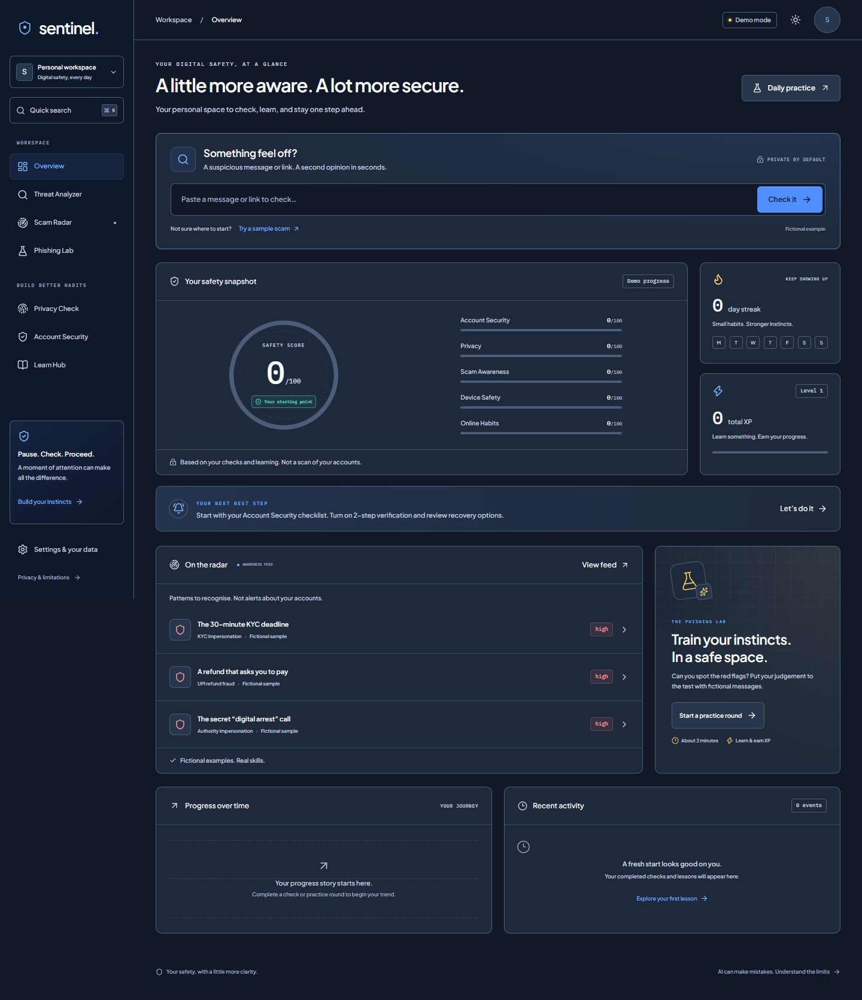

# Sentinel — Your Digital Safety Copilot

**[Open Sentinel](https://sentinel-digital-safety.100coldice.workers.dev)** · [Two-minute demo guide](DEMO_SCRIPT.md) · [Architecture](docs/ARCHITECTURE.md) · [Security and limitations](docs/THREAT_MODEL.md)

[](https://github.com/Pyrexus/Sentinals-Tool-/actions/workflows/ci.yml)

> Sentinel is configured for **live mode** with Firebase Google sign-in, Railway PostgreSQL through Cloudflare Hyperdrive, and Gemini Flash Lite. Explicitly saved messages use encrypted storage. Training examples remain fictional, and unavailable or invalid AI results use labelled fallbacks. Google Safe Browsing is optional and is not configured on this deployment.



## For judges: try this first

1. Open **Threat Analyzer**, choose **Urgent KYC request**, and select **Analyze message**. Read the highlighted evidence and safe next steps. Sign in with Google to save progress.
2. Open **Scam Radar**, expand a fictional pattern, and launch **Test yourself**.
3. In **Phishing Lab**, tap the suspicious phrases, choose a verdict, and view the feedback and earned XP.
4. Try **Privacy Check**, **Account Security**, or one of the twelve **Learn Hub** lessons, then return to your dashboard.

| What powers Sentinel | Implementation |
| --- | --- |
| Runtime and hosting | Cloudflare Workers, Static Assets and daily Cron Trigger |
| API and validation | Hono, TypeScript, Zod |
| Interface | React 18, Vite, Tailwind, Radix, Framer Motion, Lucide |
| Navigation and data UI | React Router, TanStack Query, Recharts, Plus Jakarta Sans and IBM Plex Mono |
| Live authentication | Firebase Google sign-in; server verification with jose |
| Live storage | Railway PostgreSQL, Cloudflare Hyperdrive, Drizzle |
| AI and URL signals | Gemini Flash Lite (`gemini-flash-lite-latest`), deterministic fallback, optional Google Safe Browsing |
| Verification | Vitest, Playwright, ESLint, TypeScript, gitleaks, GitHub Actions |

**Verification:** 42 passing tests, typecheck, lint, production build, live health/Radar/Analyzer smoke checks, browser checks at desktop/mobile sizes, and ten screenshots. Live provider checks produced validated Gemini results for analysis, privacy summaries, Lab scenarios, and Radar generation. The deployed browser loads Google sign-in without fatal errors. A complete Google sign-in and saved-data browser journey remains a manual release check.

A digital-safety learning app for students and first-time internet users in India. Check a suspicious message, practise on fictional examples, and build better account and privacy habits.

**Sentinel offers risk assistance, not a definitive fraud verdict.** Its Safety Score reflects learning and self-reported habits, not an inspection of your device or accounts. Seed examples are fictional and are not live threat reports.

## Run locally

Use Node.js 22 or newer and npm. From the repository root:

```powershell
npm ci
if (!(Test-Path .dev.vars)) { Copy-Item .dev.vars.example .dev.vars }
npm run build
npm run dev:api
```

In a second terminal:

```powershell
npm run dev
```

Open `http://localhost:5173`. Leave credentials blank for Demo Mode. The API runs on port 8787. Demo progress is isolated to a browser session but held in temporary Worker memory; it can reset between Worker restarts or isolates.

## What you can do

- **Analyze:** paste text or a URL, inspect quoted indicators, confidence and practical next steps. Gemini has a deterministic fallback; optional Safe Browsing is shown separately. URLs are not visited by the server.
- **Scam Radar:** explore ten bundled fictional awareness patterns or configured daily generation; launch a practice round from a card.
- **Phishing Lab:** practise with twenty fallback scenarios, select suspicious phrases and receive server-graded feedback and XP.
- **Dashboard:** see five habit/learning sub-scores, recommendation, real activity, streak, level and badges. New users start with no invented achievements.
- **Privacy, Protect and Learn:** complete a twelve-question review, six self-reported Google security steps, and twelve lessons with a practice prompt and three-question quiz each.
- **Settings:** export or delete your Sentinel data. Google/Firebase sign-in identity is managed separately.

## Stack and layout

One Cloudflare Worker serves Hono API routes and the Vite React build through Workers Static Assets. The frontend uses TypeScript, Tailwind, Radix, Framer Motion, Recharts, Lucide, TanStack Query and React Router. Production storage uses Drizzle/PostgreSQL through Hyperdrive; authentication uses Firebase Google sign-in and `jose` verification. Runtime AI uses the configured Gemini model with strict JSON validation. This deployment selects Flash Lite after the Flash endpoint returned high-demand errors; model selection is controlled by `GEMINI_MODEL`.

```text
apps/web/          React app
apps/api/          Hono Worker, security, repositories, AI and routes
shared/            Fictional content, lesson bank, audits and shared types
db/                Drizzle schema, SQL migration, migration/seed runners
docs/              Product specification, architecture and threat model
scripts/           Smoke and screenshot tooling
```

## Configuration

Never put a private credential in a `VITE_*` variable or commit `.env` / `.dev.vars`.

| Variable / binding | Where it comes from | Purpose |
| --- | --- | --- |
| `GEMINI_API_KEY` | Google AI Studio | Server-side model requests; optional for fallback demo |
| `GEMINI_MODEL` | A supported Gemini model ID | Non-secret model setting; this deployment uses `gemini-flash-lite-latest` |
| `DATABASE_URL` | Railway PostgreSQL public TCP connection URL | Local migration/seed scripts and Hyperdrive origin; not a deployed Worker secret |
| `HYPERDRIVE` | Cloudflare Hyperdrive configuration ID | Wrangler binding that supplies runtime database connectivity |
| `FIREBASE_PROJECT_ID` | Firebase project settings | Verified ID-token audience and issuer |
| `FIREBASE_WEB_CONFIG` | Firebase registered web app configuration | Public one-line JSON (`apiKey`, `authDomain`, `projectId`, `appId`); delivered by `/api/config` |
| `SAFE_BROWSING_API_KEY` | Google Cloud project with Safe Browsing enabled | Optional independent URL reputation signal |
| `DATA_ENCRYPTION_KEY` | Locally generated 32 random bytes, base64 | AES-256-GCM for explicitly saved original messages |
| `DATA_ENCRYPTION_KEY_VERSION` | Operator-chosen version, initially `v1` | Ciphertext key-version prefix; changing it does not migrate old data |
| `IP_HASH_SALT` | Locally generated random secret | Salted IP hashing for limits and audit correlation |
| `ADMIN_SECRET` | Locally generated random secret | `X-Admin-Secret` for manual Radar generation |
| `ALLOWED_ORIGIN` | Exact app origin, including scheme and port | Locked browser origin; use the deployed HTTPS origin in production |

Generate each random secret locally with this command, and save it only in your secret manager or ignored local configuration:

```powershell
node -e "console.log(require('node:crypto').randomBytes(32).toString('base64'))"
```

Enable **Authentication → Sign-in method → Google** in Firebase, register the web app, and add the development/deployed domains under authorised domains. The Firebase web config is public; the server still verifies every protected request's ID token. Production mode needs real identity and storage configuration; missing optional AI services use visibly labelled fallbacks.

## Production setup and deployment

The Cloudflare deployment has Firebase Google sign-in and its authorised production domain configured, a Railway PostgreSQL database connected through Hyperdrive, and a working Gemini Flash Lite configuration. Encryption keys and the IP-hashing salt are configured as server-side secrets. Safe Browsing remains unavailable until its optional API key is supplied. Configuration and provider checks do not replace a complete authenticated browser check of sign-in, persistence, export, and deletion.

For your own deployment, create `.env` from `.env.example` and put the Railway public PostgreSQL URL in its `DATABASE_URL` entry. Create a Hyperdrive configuration in the Cloudflare dashboard using the database origin credentials, then add its returned ID to `wrangler.jsonc`. Secret commands below prompt for their values; do not substitute private credentials into tracked files or command arguments.

```powershell
npm ci
npx wrangler login
# Load DATABASE_URL from the ignored local .env without printing it.
$databaseEntry = Get-Content .env | Where-Object { $_ -match '^DATABASE_URL=' } | Select-Object -First 1
if (!$databaseEntry) { throw 'Set DATABASE_URL in .env first.' }
$env:DATABASE_URL = $databaseEntry.Substring('DATABASE_URL='.Length).Trim().Trim('"').Trim("'")
# Add the Hyperdrive ID from the dashboard to wrangler.jsonc:
# "hyperdrive": [{ "binding": "HYPERDRIVE", "id": "RETURNED_ID" }]
# Set vars.ALLOWED_ORIGIN there to your exact deployed HTTPS origin.
# Set vars.GEMINI_MODEL to a supported model, e.g. "gemini-flash-lite-latest".

npx wrangler secret put FIREBASE_PROJECT_ID
npx wrangler secret put FIREBASE_WEB_CONFIG
npx wrangler secret put GEMINI_API_KEY
npx wrangler secret put DATA_ENCRYPTION_KEY
npx wrangler secret put DATA_ENCRYPTION_KEY_VERSION
npx wrangler secret put IP_HASH_SALT
npx wrangler secret put ADMIN_SECRET
# Optional; omit if you do not want Google Safe Browsing lookups:
npx wrangler secret put SAFE_BROWSING_API_KEY

npm run db:migrate
npm run db:seed
npm run typecheck
npm test
npm run build
npm audit --omit=dev
npm run secrets:scan
npm run deploy
# Use the public URL reported by Wrangler:
$env:SMOKE_URL = 'https://YOUR_WORKER.YOUR_SUBDOMAIN.workers.dev'
npm run smoke
```

The smoke check covers public health, Radar, and unsaved analysis in both demo and live mode. Saving messages and managing personal progress require a valid Firebase ID token; verify those flows through the signed-in app. An unauthenticated `401` from a protected route is expected.

The daily Cron Trigger is `30 0 * * *`: 00:30 UTC, or 06:00 India time. Manual generation uses `POST /api/radar/generate` with `Content-Type: application/json`, an empty JSON object, and `X-Admin-Secret`. Keep the admin secret out of browser bundles and screenshots. Generated examples are fictional, validated and source-labelled.

If your environment blocks a command, run it in your own terminal and retain the exact error or output. Do not claim a deployment, successful provider call, or clean secret scan until it actually completes.

## Quality checks and demo materials

```powershell
npm run typecheck
npm test
npm run build
npm audit --omit=dev
npm run secrets:scan
# Against a running local API or a deployed Worker:
$env:SMOKE_URL = 'http://localhost:8787'
npm run smoke
# With the app running; see scripts/screenshots.mjs for URL options:
npm run screenshots
```

The repository provides a gitleaks pre-commit hook. Enable it with `git config core.hooksPath .githooks` after installing gitleaks from its [official releases](https://github.com/gitleaks/gitleaks/releases). Git history passed the secret scan. CI performs type checks, tests and a production dependency audit. Ten browser screenshots were captured with Microsoft Edge in `docs/screenshots`. The capture script defaults to installed Edge (`BROWSER_CHANNEL=msedge`); see [DEMO_SCRIPT.md](DEMO_SCRIPT.md) for capture instructions and the two-minute flow.

## Privacy, limitations and responsible use

- Default persistent analysis records and the 24-hour repository cache retain limited metadata, omitting the raw message and free-text output that could reproduce it. Highlights are rebuilt from the current request. Full input/output is handled transiently for that request and reaches your browser; it is not retained in the analysis cache. Do not paste information you are not comfortable processing.
- If Gemini is configured, pasted content is sent to Google for analysis. Optional Safe Browsing sends candidate URLs to Google. Infrastructure and providers have their own retention policies.
- Saving original text requires explicit opt-in and an encryption key. Each record uses AES-256-GCM with a random IV and versioned key prefix. Exports can contain ciphertext; preserve old keys when planning rotation.
- Export/deletion is scoped to your Sentinel user. Deletion does not delete Google/Firebase identity, infrastructure backups, or external-provider records. A live operator must define backup retention.
- Scores measure practice and self-reported habits. They are not scan results, certifications, guarantees, or evidence of real account settings.
- Models and heuristics can miss scams or flag benign content. Confidence is not calibrated detection accuracy. Verify through official apps, known bookmarks, or the number on your bank card. Never share OTP, PIN or CVV.
- The Radar bank and lab scenarios are fictional samples. Generation is not a report of newly observed incidents. Safe Browsing may be unavailable or incomplete; a clean lookup does not establish safety.
- Free-tier quotas and provider downtime affect availability. Production generation uses an atomic 30-second database lease to deduplicate work across instances; demo coordination and storage remain temporary and per-isolate. Recheck your configured providers and authenticated flows after changing deployments or credentials.
- Screenshot/QR-image analysis, Hindi localisation, push notifications, certificates and a leaderboard are not part of this build.

Read [SPEC](docs/SPEC.md), [ARCHITECTURE](docs/ARCHITECTURE.md), [THREAT_MODEL](docs/THREAT_MODEL.md), [SECURITY](SECURITY.md), and [AI_USAGE](AI_USAGE.md). Original repository code is licensed under [MIT](LICENSE); dependencies retain their own licenses.
