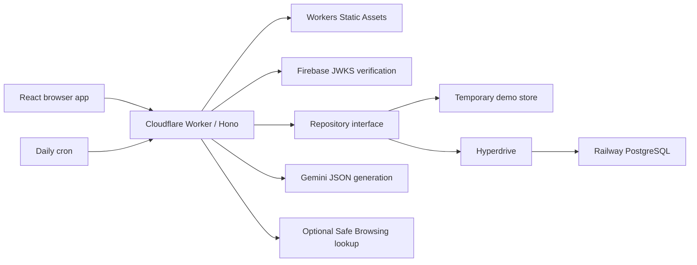

# Architecture

## Request path

The Vite production build is served by the same Worker as `/api/*`. React Router handles page navigation. Local development runs Vite on port 5173 and Wrangler on 8787; the frontend proxies API requests.

Hono applies origin checks, security headers, bounded request bodies, identity verification, and per-IP/per-user limits. Successful API responses use `{apiVersion:"1", demo, data}`; errors use `{error:{code,message}}` and appropriate status codes.

## Modules

- `apps/web`: React interface, reusable UI, navigation, charts, animation and query state.
- `apps/api/index.ts`: Worker entry, middleware, API routing, static asset serving and scheduled generation.
- `apps/api/routes`: analysis, radar, lab, lessons, audits, dashboard and data-management handlers.
- `apps/api/core`: identity, encryption, environment types and interchangeable repositories.
- `apps/api/ai`: versioned prompts, strict schemas, bounded provider client, cache, heuristic analysis and optional Safe Browsing.
- `shared`: content types, ten radar seeds, twenty lab scenarios, twelve lessons and audit questions.
- `db`: parameterized Drizzle schema, PostgreSQL migration and seed runners.

## Storage and identity

Production repositories connect through Hyperdrive to Railway's public PostgreSQL endpoint. Database ownership checks use the verified Firebase UID. The Worker verifies token signature, issuer, audience and expiry against Google's JWKS; it does not trust a UID supplied in a request body.

The demo repository is process-local and isolates user progress by a browser session cookie. It is suitable for demonstration, not durable production data or globally coordinated rate limits. Different Worker isolates do not share its memory.

The schema covers users, analyses, radar items, lab attempts, progress, badges, privacy audits, checklist state, audit events and rate-limit counters. User-facing progress derives from stored activities and submitted reviews, not seeded achievement metrics.

## AI flow

Pasted content is untrusted input, including any instructions contained in it. Analysis uses a versioned prompt, JSON response schema and Zod validation. Strings are sanitised and rendered as text. Provider attempts are time-bounded, retry once, and use deterministic heuristics if usable output is unavailable.

Analysis caches retain limited metadata by content hash for 24 hours in the repository. Quoted highlights are rebuilt from the current request using the heuristic analyzer, so the cache does not retain raw message text or the full free-text response. An atomic 30-second database generation lease deduplicates generation across production instances; the in-memory demo equivalent is limited to one isolate. Radar is keyed by date and persisted through the repository. Cron is set to `30 0 * * *` (00:30 UTC / 06:00 India time).

No user-supplied URL is fetched. Safe Browsing receives candidate URLs only through its fixed Google API endpoint; it is presented separately from the language-model assessment.

## Data minimisation

Default analysis persistence keeps a hash and non-sensitive assessment metadata, excluding the raw input and free-text excerpts that could reproduce it. Raw input and the complete response are handled transiently during the current request and returned to the requesting browser; the analysis cache does not retain them.

When the user explicitly opts to save a message and an encryption key is configured, the original text is encrypted with AES-256-GCM, a fresh IV, and a key-version prefix. The key stays in Worker secrets. The export can contain encrypted ciphertext, not a promise of portable plaintext recovery. Key rotation requires retaining the old key material and an intentional migration strategy.

Raw IPs are not persisted by application code; a salted hash is used for limits/audit correlation. Cloudflare, Firebase, Railway and Google APIs have their own processing and logging behavior outside this repository's control. Pasted content is transmitted to Google when model analysis is enabled.
